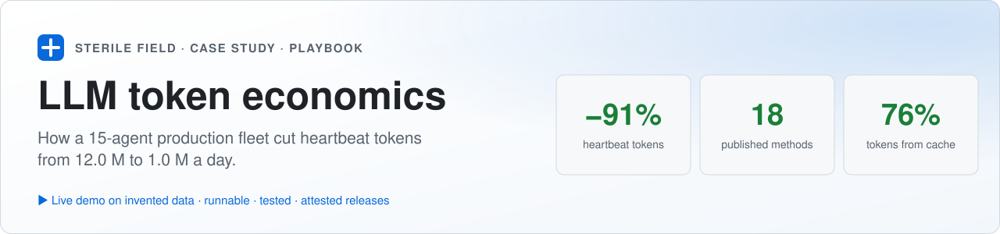
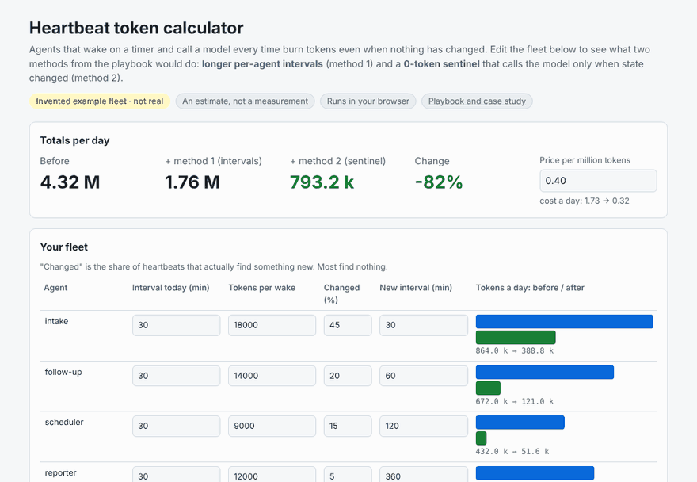
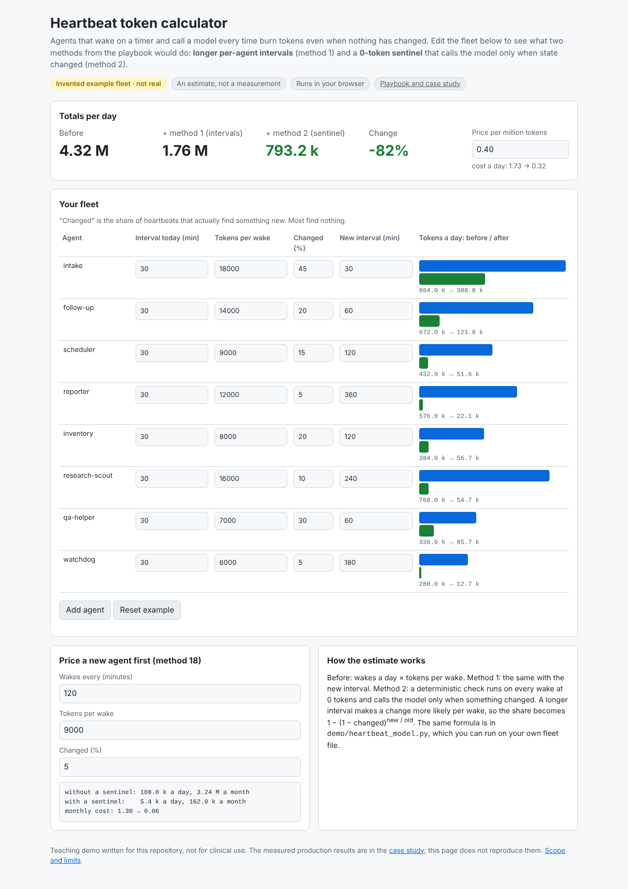

<p align="center"><a href="https://sterilefield.github.io/llm-token-economics/"><picture>
  <source media="(prefers-color-scheme: dark)" srcset="docs/img/hero-dark.svg">
  
</picture></a></p>

# LLM token economics

**How a 15-agent production fleet went from 12.0 M to 1.0 M heartbeat tokens a day (−91%), and the 18 methods behind it.**

A case study and playbook from production multi-agent systems built on the same platform, including a 15-agent WhatsApp and Telegram operations platform for a real-estate brokerage (client anonymised). The figures come from per-agent, per-run token telemetry. No prompts, configurations or client data are published here.

> [!IMPORTANT]
> **Status:** Playbook from measured production data (per-agent, per-run token telemetry). Last verified 21 Oct 2026. Not for clinical use as-is. Scope and limits: [TRUST.md](TRUST.md).

**[Methods](docs/methods.md) · [Heartbeat case study](docs/case-study-heartbeat-diet.md) · [Checklist](docs/checklist.md) · [Trust](TRUST.md) · [All showcases](https://github.com/sterilefield) · [Contact](https://www.linkedin.com/in/dr-ravi-teja-thiriveedhi)**

[](https://github.com/sterilefield/llm-token-economics/actions/workflows/ci.yml) [](https://sterilefield.github.io/llm-token-economics/) [](https://codespaces.new/sterilefield/llm-token-economics) [](https://scorecard.dev/viewer/?uri=github.com/sterilefield/llm-token-economics) [](https://github.com/sterilefield/llm-token-economics/releases/latest) [](#verify-this-release)

### See it in action

<a href="https://sterilefield.github.io/llm-token-economics/"></a>

<sub>Recorded from the live demo page with scripted clicks, on invented data. [Open the demo](https://sterilefield.github.io/llm-token-economics/) to try it yourself.</sub>

## Results

| Measure | Before | After | Change |
|---|---|---|---|
| Heartbeat tokens per day (fleet) | 12.0 M | 1.0 M | −91% |
| Largest single agent, heartbeat tokens per day | 7.2 M | 0.47 M | −93% |
| A low-frequency agent, heartbeat tokens per day | 1.3 M | 5 k | ~−100% |
| Extraction cost per WhatsApp message | ~38 k tokens | ~4 k tokens | −89% (1,177 turns, 0 errors) |
| Share of tokens served from prompt cache | — | 76% | — |
| Marginal API cost per lead | — | ₹0 | free-first routing |

Accounting runs per agent, per run and per day from the moment of the change.

## The principle

1. **Deterministic work first.** If plain code can answer, no model is called.
2. **An LLM only when something has changed.** Most heartbeats find nothing new.
3. **The smallest model that does the job.** Premium models are reserved for judgement.
4. **Measure every token.** Telemetry is collected by code, at 0 tokens.
5. **Show every saving as a before/after table** on the owner's own dashboard.

## The 18 methods, in five groups

| Group | Methods | Biggest effect |
|---|---|---|
| A · Heartbeat diet | Per-agent heartbeat intervals · 0-token gate sentinel · before/after accounting | −91% fleet heartbeat tokens |
| B · Right-sized agents and models | Dedicated minimal agent for single-purpose calls · three-tier model ladder · two-tier extraction (rules → LLM) · bilingual glossary in the prompt · local models for bulk or private work · free-first routing with tracked fallbacks | ~38 k → ~4 k tokens per message |
| C · Zero-token engineering | Deterministic engines for monitoring and knowledge · rate-limited LLM curators · read the provider dashboard, not the model · cache-friendly prompts | 76% of tokens from cache |
| D · Budgets, caps and windows | Daily budget gauge · per-feature caps · idle-aware job windows with 7 pre-checks · rate-limit capacity learned from past 429s | No 429 errors in 24 h at 3% of learned capacity |
| E · Economics and governance | Unit economics per lead and per deal · price a new agent before building it | Cost known before code is written |

Each method is written up with the problem, the change and the measured effect in [docs/methods.md](docs/methods.md). The heartbeat diet, the largest single win, is walked through in [docs/case-study-heartbeat-diet.md](docs/case-study-heartbeat-diet.md).

## Use it on your own fleet

[docs/checklist.md](docs/checklist.md) is a one-page audit you can run against any agent system this week: what to measure first, which heartbeats to cut, and which calls to move to rules or smaller models.

## Related

- [empire-os-reference-architecture](https://github.com/sterilefield/empire-os-reference-architecture): the governed multi-agent platform these methods run on.

## Try it

**[Heartbeat token calculator](https://sterilefield.github.io/llm-token-economics/)**: edit an example fleet and see what per-agent intervals and a 0-token sentinel do to daily tokens; price a new agent before building it. It runs in your browser on invented data.

<a href="https://sterilefield.github.io/llm-token-economics/"><picture>
  <source media="(prefers-color-scheme: dark)" srcset="docs/img/demo-page-dark.png">
  
</picture></a>

Or run the same logic yourself (Python 3, standard library only, nothing to install):

```bash
git clone https://github.com/sterilefield/llm-token-economics.git
cd llm-token-economics
python3 demo/heartbeat_model.py
```

<picture>
  <source media="(prefers-color-scheme: dark)" srcset="docs/img/demo-terminal-dark.svg">
  
</picture>

The terminal image is the real output of that command, rendered by `scripts/term_svg.py`. Everything in `demo/` and `site/` is a calculator written for this repository on invented data. It is not production code, and the tests in `tests/` run on every pull request.

## How this was built

I write the specifications, architecture, acceptance criteria and review gates; AI coding agents (Claude Code and Codex) write most of the code under those specifications. I own every review, test gate, release decision and production operation. Text in this repository was drafted with AI assistance and passed gate G4, a review by a fresh-context AI agent that did not write it, before my own approval (G5).

## Verify this release

Every release carries a build-provenance attestation for its source archive and an SPDX SBOM (the SBOM is attested too from v0.2.0). These commands fetch the latest release into a new folder and check both attestations:

```bash
gh release download -R sterilefield/llm-token-economics -p '*.tar.gz' -p 'sbom.spdx.json' -D verify-latest
gh attestation verify verify-latest/llm-token-economics-*.tar.gz -R sterilefield/llm-token-economics
gh attestation verify verify-latest/llm-token-economics-*.tar.gz -R sterilefield/llm-token-economics --predicate-type https://spdx.dev/Document/v2.3
```

## Author

**Dr. Ravi Teja Thiriveedhi**: clinician turned AI systems architect, with 20 years of clinical practice and hospital operations. [GitHub](https://github.com/Raviteja2k2k) · [LinkedIn](https://www.linkedin.com/in/dr-ravi-teja-thiriveedhi)

## Licence

Documentation in this repository is licensed under [CC BY-NC-ND 4.0](LICENSE). Share it with credit; no commercial use and no derivatives.

Code (source files in `demo/`, `tests/`, `scripts/` and `site/`, plus `.github/workflows/` and `.devcontainer/`) is licensed under [Apache-2.0](LICENSE-CODE), so you can run, adapt and reuse it with attribution. Everything else, including all Markdown, `docs/img`, `llms.txt` and `CITATION.cff`, is documentation under [CC BY-NC-ND 4.0](LICENSE). [NOTICE](NOTICE) holds the attribution notice Apache-2.0 asks redistributors to keep, plus a healthcare and safety notice.
