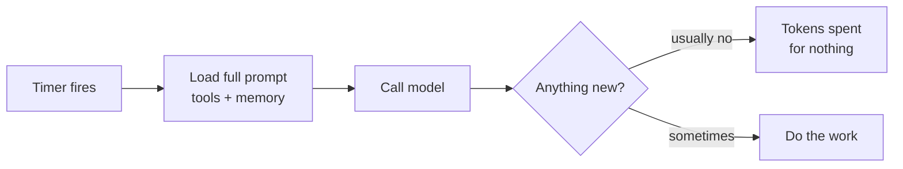
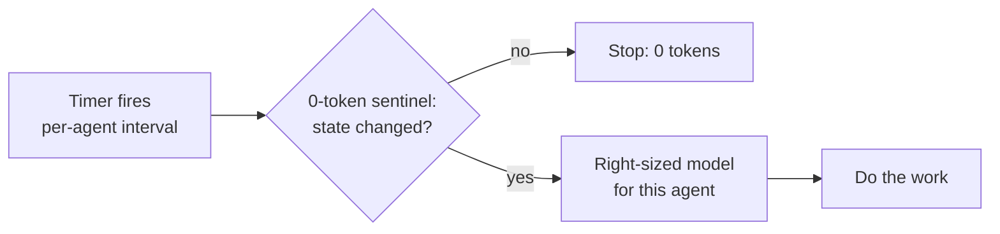

# Case study: the heartbeat diet

## Situation

A brokerage's operations platform ran 15 agents on WhatsApp and Telegram. Each agent "woke up" on a fixed heartbeat to check for work. Most heartbeats found nothing, but every one of them loaded a full prompt and called a model.

Over a 30-day window, 473.4 M tokens were used and heartbeats were 433 M of that, mostly before the change.

## Diagnosis

Measuring token use per agent and per run showed that heartbeats, not customer work, were the cost.

## Change

1. **Intervals per agent.** The live intake agent checks every 2 hours, slower agents every 4–24 hours, and 11 agents only run on schedule.
2. **A deterministic sentinel** checks for changed state in plain code. A model is called only when something changed.
3. **Accounting from the moment of the change**, per agent and per day, so the result is measured, not estimated.

## Result

| Agent group | Before (tokens/day) | After (tokens/day) | Change |
|---|---|---|---|
| Fleet total | 12.0 M | 1.0 M | −91% |
| Largest agent (live intake) | 7.2 M | 0.47 M | −93% |
| A low-frequency agent (24 h interval) | 1.3 M | 5 k | ~−100% |
| Several support agents | — | — | −97% to −99% |

After the change, the measured 7-day total was 9.3 M tokens; on the day measured, use was 1.5 M against a 15 M budget (10%), with no 429 rate-limit errors in 24 hours.

## What carried over

The same pattern of rules first, a model on change and the smallest model that works then cut extraction from ~38 k to ~4 k tokens per message. See [methods.md](methods.md), method 4.
